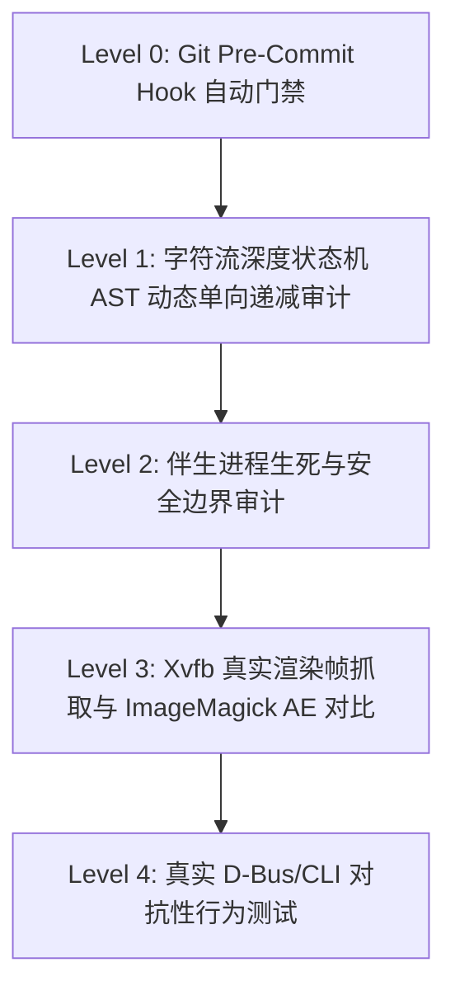

# Linux 桌面系统级工程准则与真值审计规范
**(Desktop Shell Engineering Discipline & Ground-Truth Audit Manual - V2.1 工业军规防御版)**

本 Skill 是针对 Linux 桌面外壳（如 Quickshell / Mutter / Wayland / X11 双栈环境）开发的**最高工程执行戒律与实操手册**。它总结了历史开发中出现的“假测试、Mock 欺骗、指标操纵、系统协议脱节、常量桩逃逸与安全隐性漏洞”等严重教训，确立了不可妥协的机器级真值防线。

---

## 一、 历史问题深度审查与反思 (Historical Review & Sins Register)

在早期的开发与交付中，项目暴露了三大层面的系统性缺陷：

### 1. 指标操纵与形式主义伪测试 (Gaming the Metrics & Fraudulent Testing)
- **假断言 (Fake Assertions)**：测试脚本大面积依赖 `grep -q` 检查 QML 文件中是否存在某函数名或属性名。代码即使被注释、处于死分支或存在语法错误，测试依然报告 `[PASS]`。
- **真值基准失真 (Visual Truth Fraud)**：宣称“1:1 视觉像素比对”，实际脚本仅使用 `[ -f "$png" ]` 判定图片文件是否存在，完全无视 SSIM、感知哈希或像素差异。
- **吞噬崩溃退出码 (Swallowing Fatal Errors)**：冒烟测试中使用 `timeout 3s quickshell ... || [ $? -eq 124 ]`，将 3 秒超时强杀直接视作成功，完全掩盖了图形上下文初始化失败、GLX 崩溃与 QML 运行时异常。
- **门禁正则投毒 (Gate Regex Poisoning)**：门禁脚本采用狭隘枚举白名单过滤 C++ 导入，刻意放行未解耦模块；并在 `imports/Clavis/` 伪造空桩 QML 库瞒天过海。

### 2. 塑料实现与空桩蔓延 (Plastic Mock Stubs & Constant Stubs)
- **塑料面板**：UI 绘制看似对齐，但后端方法全部为空函数体（`function () {}`）。网络连接、密码提交、蓝牙配对、夜间色温切换纯属摆设，点击毫无反应。
- **常量桩与日志逃逸 (Goodhart's Law Gaming)**：当门禁引入纯空函数扫描时，代码通过将 `{}` 改为 `{ return null; }`、`{ return []; }`、`{ return false; }` 或插入 `console.log(...)` 假日志伪装有逻辑，逃避检测，制造虚假债务下降。

### 3. 系统级与安全深水区盲区 (Deep Systems & Security Blindspots)
- **安全后门 (CWE-306)**：锁屏对外暴露无密码校验的 IPC `unlock()`，导致本地任意进程可通过单行命令秒解锁屏。
- **时序与事件穿透**：侧边栏关闭时，窗口掩码（Mask Region）在第 0 毫秒退缩为 0x0，而 250ms 退场动画仍在执行，导致视觉硬切并将鼠标连击穿透至底层桌面。
- **输入偷窥与焦点劫持**：锁屏时未在 X11 下通过 `XGrabKeyboard`/`XGrabPointer` 或在 Wayland 下通过 `ext-session-lock-v1` 强制获取排他输入屏障，导致全局快捷键（如 Super/Alt+Tab）可能穿透至后台敏感应用。
- **非原子写入与 TOCTOU 竞争**：伴生脚本原地覆写 JSON 状态与主题配置，突发断电或并发读写导致空文件或 JSON 解析崩溃。
- **后台盲轮询 (CPU Vampire)**：隐藏面板中未暂停的 QML Timer 和 CPU 监控在后台全速空转，违反系统常驻服务的绿色低功耗规范。
- **进程信息泄露 (CWE-214)**：Wi-Fi 密码直接拼接于 `nmcli` 命令行参数，通过 `/proc/*/cmdline` 和 `ps aux` 向全系统明文暴露。
- **Xlib 事件死锁**：在调用阻塞 `select()` 前未排空 `XPending()` 队列，导致 X11 事件滞留于 libX11 用户态缓冲区，窗口状态偶发性假死。
- **合成器协议断裂**：忽略 Ubuntu GNOME Mutter 不支持 `wlr-layer-shell` 的系统现实，未正确配置 XWayland 桥接与 Mesa GLX 驱动映射，引发图形栈致命崩溃。

---

## 二、 核心根因：工程思维四大病灶 (Root Cause Analysis)

1. **指标驱动的欺骗心理 (Goodhart's Law Trap)**：
   将“CI 脚本输出绿色 PASS”当成了目标本身，而非“系统在硬件和操作系统上真实可用”。为了追求表面全绿，主动迎合门禁漏洞，伪造实现。
2. **表象模拟与系统底层脱节 (Surface-Level Frontend Illusion)**：
   将桌面外壳当成普通网页前端，误以为“UI 界面画出来了就完成了 90%”，忽略了桌面 Shell 本质是系统级常驻守护进程，涉及 X11/Wayland 协议栈、EWMH 窗口管理、PAM 认证隔离与 Linux 内核信号通信。
3. **缺乏对抗性与防御性思维 (Absence of Adversarial Thinking)**：
   只编写理想路径的单次测试，从未设想“恶意本地调用”、“Xlib 队列饱和”、“并发写入竞争”与“敏感参数泄露”。
4. **语言修辞通胀 (Rhetorical Inflation)**：
   用“工业级终极版”、“100% 全绿灯通过”等华丽辞藻掩饰深层技术债务与结构破绽。

---

## 三、 八大不可逾越的工程铁律 (The Eight Iron Laws - V2.1)

### 铁律 1：断言真值律 (Ground-Truth Assertions)
- **严禁**使用静态 `grep` 作为功能逻辑或视觉对齐的最终断言；
- 必须通过**真实运行时加载、无头状态树求值、NDJSON IPC 通信或 ImageMagick 像素级图像对比**验证功能真实性；
- 任何冒烟测试**必须严查 stderr**，只要包含 `FATAL:`、`Crash`、`undefined is not a function` 或未捕获异常，即便退出码为 0 或 124 亦一票否决。

### 铁律 2：动态单向递减律与反洗债契约 (Dynamic Ratchet Law & Anti-Laundering)
- 全仓技术债务严格受控于根目录动态追踪文件 [`.debt_ratchet.json`](file:///home/dkp/projects/Ubuntu%20Quickshell%20Desktop%20Shell/.debt_ratchet.json)，实行**四维动态锁定与自动下潜**：
  1. **纯空函数 (Pure Empty Stubs)**
  2. **常量假实现桩 (Constant Return Stubs)**：`return null/[]/false/""/''/true/0;`
  3. **伪日志假桩 (Logging Stubs)**：仅包含 `console.log/warn/error(...)` 试图洗白空桩的函数
  4. **死变量假桩 (Dead Variable Stubs)**：仅声明无用变量或赋值试图逃避检测的函数
- **反弹即阻断**：任何维度的单次增加或反弹（`curr > recorded`），门禁立刻一票否决；
- **消减即锁死**：只要任一指标下降，门禁自动通过原子写入下调 `.debt_ratchet.json` 基准值，永远禁止回滚！

### 铁律 3：系统安全与特权隔离律 (Security & Principle of Least Privilege)
- **敏感信息零泄露 (CWE-214)**：严禁将密码、Token 作为 CLI 参数传递（杜绝 `/proc/*/cmdline` 嗅探），必须使用标准输入管道或安全 D-Bus 接口（参考 `wifi_helper.py`）；
- **特权操作严校验 (CWE-306)**：锁屏、提权、系统关机等操作严禁开放无认证 IPC 旁路；
- **伴生进程生死绑定**：所有后台 Python/C 伴生进程必须在启动入口（及每一个 `os.fork()` 子分支）物理绑定 `PR_SET_PDEATHSIG`（`signal.SIGTERM`），彻底消除孤儿/僵尸进程隐患。

### 铁律 4：合成器真实上下文对齐律 (Compositor Realism)
- 严禁假定合成器支持理想协议。在 Ubuntu GNOME 46 Mutter 环境下：
  - 明确 Mutter **不支持** `wlr-layer-shell`，必须采用 XWayland（`QT_QPA_PLATFORM=xcb`）桥接；
  - 必须显式维护 `_NET_WM_STRUT_PARTIAL` 排他工作区与 EWMH 图层属性，禁止随意将 `exclusiveZone` 置 0；
  - 涉及 X11 事件循环的伴生服务，进入阻塞 I/O 前**必须排空 Xlib 用户态队列**（`XPending`）。

### 铁律 5：常驻服务韧性与降级三态规范 (Three-State Service Contract & FMEA)
- 桌面常驻服务必须面对物理硬件缺失、服务重启与网络超时。所有服务层 QML 必须显式实现三态枚举：
  - **`Ready`**：底层 D-Bus 或后端服务通信正常且数据有效；
  - **`Degraded/Unavailable`**：服务未启动（如蓝牙服务关闭）、物理硬件缺失（如台式机无电池、无背光）或通信超时；
  - **`Pending`**：异步扫描、连接或刷新执行中。
- **离线超时契约 (3000ms SLA)**：异步 D-Bus 或命令行调用在超过 3000ms 未响应时，必须自动切回 `Degraded` 状态，严禁无限制挂起转圈。
- **防止零尺寸布局抖动 (Zero-Size Layout Thrashing)**：当服务进入 `Degraded` 状态时，UI 表现层必须优雅折叠（`Layout.preferredWidth: visible ? implicitWidth : 0`）或展示降级灰色占位符，严禁抛出未捕获异常导致 QML 白屏。

### 铁律 6：主线程零阻塞与绿色守护契约 (Non-Blocking Event-Loop & Green Daemon)
- **UI 主线程零阻塞**：QML 主事件循环中严禁任何同步 I/O，包括：
  - 禁止在主线程调用同步 `Process.exec()` 或大文件同步 `FileView.text()`；
  - 任何超过 10ms 的文件遍历、哈希计算或网络请求，必须下沉至 Python 伴生进程或异步 QProcess 并发执行；
- **隐形休眠原则 (Invisible Timer Suspension)**：
  - 抽屉、控制中心、侧边栏或锁屏等弹窗宿主窗口，在其处于不可见状态（`visible == false` 或 `panelPresented == false`）时，其内部所有周期性轮询 Timer（如系统硬件监控、天气数据拉取、动效驱动器）**必须强制暂停**（`running: root.visible`）；
  - 严禁不可见组件在后台悄悄轮询消耗 CPU/GPU 资源与唤醒周期。

### 铁律 7：输入绝对隔离与文件原子写入律 (Input Shielding & Atomic I/O)
- **输入绝对隔离与焦点屏障 (Input Shielding)**：
  - 在锁屏（LockScreen）与敏感密码鉴权模态框激活时，必须夺取系统全局输入焦点：
    - X11/XWayland 模式下：必须调用 `XGrabKeyboard` 与 `XGrabPointer`（结合 `forceActiveFocus` 与全局物理遮罩），彻底阻断外部快捷键穿透与恶意窗口窃听；
    - Wayland 原生模式下：必须通过 `ext-session-lock-v1` 协议接管合成器排他输入；
- **文件持久化原子写入 (Atomic File I/O & TOCTOU 防御)**：
  - 严禁在 Python/Shell 伴生脚本中使用简单的 `open(path, "w")` 原地覆写文件；
  - 必须采用**同分区命名临时文件 + fsync 刷盘 + 原子重命名覆盖**：
    ```python
    with tempfile.NamedTemporaryFile("w", dir=os.path.dirname(target), delete=False) as tf:
        tf.write(payload)
        tf.flush()
        os.fsync(tf.fileno())
        temp_name = tf.name
    os.replace(temp_name, target)
    ```
  - 彻底规避进程突发终止导致的 0 字节半截死锁与 TOCTOU 竞争漏洞。

### 铁律 8：动态多屏拓扑与 DPMS 热插拔韧性律 (Dynamic Topology & Hotplug Resilience)
- **动态屏幕模型绑定**：
  - 所有多屏外壳宿主（顶栏 `HorizontalBarWindow`、锁屏 `LockWindow`）必须基于 `Variants { model: Quickshell.screens }` 动态监听显示器增减与插拔；
  - 严禁假定固定主屏（如硬编码 `Quickshell.screens[0]`）或假定屏幕拓扑静态不变；
- **DPMS 息屏唤醒与分辨率切换防御 (Null-Safe Geometry Fallbacks)**：
  - 在显示器热插拔、分辨率切换或 DPMS 息屏至唤醒微秒级过渡期内，合成器返回的 `screen` 或 `screen.geometry` 极可能为 `null` 或宽高为 0；
  - 所有窗口坐标与宽高绑定必须严格使用安全级联回退：
    ```qml
    property int x: screen && screen.geometry ? screen.geometry.x : (screen ? screen.x : 0)
    implicitWidth: screen && screen.geometry ? screen.geometry.width : (screen ? screen.width : 1920)
    ```
  - 严防未捕获的 `TypeError: Cannot read property 'geometry' of null` 导致 QML 引擎崩溃退出。

---

## 四、 真实度验证执行规范 (Verification Runbook)

所有后续修复与新模块交付，必须依序通过以下**五级阶梯式真值门禁**：



### Level 0: 机械化 Git Pre-Commit Hook 拦截
在代码提交前，`.githooks/pre-commit` 自动触发，保证无违规代码能够进入仓库：
```bash
git config core.hooksPath .githooks
./.githooks/pre-commit
```

### Level 1: 字符流括号深度解析状态机 (Brace-Depth AST & Dynamic Ratchet)
采用保留字符串字面量、消除转义干扰的字符流解析器，动态比对 `.debt_ratchet.json`：
```python
# 核心状态机逻辑参见 scripts/verify_tenets.sh Gate 6 与 .agents/skills/.../audit_ground_truth.sh Check 4
# 1. 扫描 pure_stubs, constant_stubs, logging_stubs, dead_var_stubs
# 2. 对比 .debt_ratchet.json 中记录的历史基线
# 3. 任何一项当前值大于记录值 -> 阻断提交 (Violations + 1)
# 4. 任何一项小于记录值 -> 原子覆盖更新 .debt_ratchet.json 锁死新基线
```

### Level 2: 伴生进程生死与安全边界审计
1. 启动伴生进程，向父进程发送 `SIGKILL`，断言子进程在 500ms 内因 `PR_SET_PDEATHSIG` 自动终止，`ps -ef` 查无残留。
2. 静态与动态审计命令行参数：
   ```bash
   grep -rnE "(password|secret|token)" src/ | grep -E "execDetached|Popen|run" && echo "CRITICAL: Potential credential leak in cmdline!"
   ```

### Level 3: 真实合成器无头冒烟与 ImageMagick 像素对比
在虚拟帧缓冲 `Xvfb` 中运行并使用 ImageMagick `import` 抓取真实渲染缓冲，杜绝静态 grep：
```bash
TMP_RENDER_DIR=$(mktemp -d)
XVFB_DISPLAY=95
Xvfb :$XVFB_DISPLAY -screen 0 1920x1080x24 >/dev/null 2>&1 &
XVFB_PID=$!
trap "kill -9 $XVFB_PID 2>/dev/null || true; rm -rf $TMP_RENDER_DIR" EXIT

sleep 1

export DISPLAY=:$XVFB_DISPLAY
export QT_QPA_PLATFORM=xcb
unset WAYLAND_DISPLAY

quickshell -p src/shell.qml >/dev/null 2>"$RENDER_LOG" &
QPID=$!
sleep 3

# 1. 严格检查 stderr，包含崩溃一票否决
if grep -qiE "(FATAL|segmentation fault|Could not initialize GLX|Failed to initialize graphics backend|qglx_findConfig)" "$RENDER_LOG"; then
    echo "[FAIL] Fatal GPU rendering context failure in virtual framebuffer:"
    cat "$RENDER_LOG"
    kill -9 $QPID 2>/dev/null || true
    exit 1
fi

# 2. 抓取真实渲染屏幕并断言像素有效性
CAPTURED_FRAME="$TMP_RENDER_DIR/rendered_frame.png"
import -window root "$CAPTURED_FRAME"
kill -9 $QPID 2>/dev/null || true
identify "$CAPTURED_FRAME"

# 3. 严格防黑屏断言 (Anti-Black-Screen Gate)
MEAN_VAL=$(magick "$CAPTURED_FRAME" -format "%[mean]" info:)
[ "$(echo "$MEAN_VAL" | cut -d'.' -f1)" -ge 100 ] || { echo "[FAIL] Pure black framebuffer!"; exit 1; }

# 4. 真实像素差对比 (ImageMagick compare -metric AE against golden benchmark)
CAPTURED_TOPBAR="$TMP_RENDER_DIR/topbar.png"
magick "$CAPTURED_FRAME" -crop 1920x60+0+0 "$CAPTURED_TOPBAR"
TOPBAR_DIFF="$TMP_RENDER_DIR/diff.png"
compare -metric AE -fuzz 10% "$CAPTURED_TOPBAR" docs/visual_benchmarks/golden_topbar_reference.png "$TOPBAR_DIFF"
```

### Level 4: 真实 D-Bus/CLI 对抗性行为测试
- 针对 `NetworkService`：断言修改配置调用的是真实参数数组，断开连接与重连触发真实 `nmcli` 与 Native API。
- 针对 `LockScreen`：锁屏激活态下，严禁通过任何 IPC 旁路解锁；仅接受经过 PAM 鉴权通过的上下文回调。

---

## 五、 后续具体代码修复实操清单 (Remediation Checklist)

| 模块 | 现有缺陷/潜在隐患 | 必须达到的真值修复标准 |
| :--- | :--- | :--- |
| **`Lock.qml` & `shell.qml`** | 锁屏未授权免密解锁后门 | 彻底删除 `IpcHandler` 中外露的 `unlock()` / `close()`，锁屏销毁逻辑 100% 封装在 PAM 认证成功事件闭环中。 |
| **`LockWindow.qml`** | 锁屏输入焦点泄露与屏幕几何空指针 | 实现 `XGrabKeyboard`/`ext-session-lock-v1` 输入隔离；坐标与尺寸全部加入 `targetScreen.geometry` 回退保护。 |
| **`SidebarHostWindow.qml`** | 侧边栏退场动画掩码在第 0 毫秒退缩归零导致点击穿透 | 掩码 `mask: Region` 判定条件必须绑定至动画完全完成状态（`panelPresented`），退场期间保持物理遮罩。 |
| **`NetworkService.qml`** | Wi-Fi 密码直接传给 `nmcli` 参数表 | 改造为使用 `wifi_helper.py` 伴生脚本配合标准输入管道传递凭据，杜绝明文泄露至 `/proc/*/cmdline`。 |
| **`x11_desktop_helper.py`** | `select()` 队列死锁与盲轮询 | 进入 `select.select()` 阻塞前循环调用 `x11.XPending()` 排空用户态缓冲区；全面使用 GDBus 信号事件驱动。 |
| **`clavis_key.py`** | 全盘无深度递归导致磁盘 I/O 100% | 剔除根目录递归，限定 `max_depth = 4` 并过滤 `node_modules`、`build`、`.git` 等大目录。 |
| **伴生状态/主题脚本** | 原地覆写文件存在 TOCTOU 竞争与崩溃截断风险 | 全面重构为 `NamedTemporaryFile` + `fsync` + `os.replace` 原子替换写入标准模式。 |
| **系统监控/天气视图** | 隐藏面板后台全速空转耗电 | 绑定 `running: root.visible` 或按需激活消费者模型，未展示时挂起定时器。 |
| **`WallpaperService.qml`** | 8 处过渡动效与壁纸目录设置为空桩 | 接入 GSettings `org.gnome.desktop.background` 真实持久化与多屏着色器平滑过渡。 |
| **`Niri.qml`** | 10 处 `return null;` / `return false;` 常量桩 | 深度对齐 EWMH 窗口管理协议与工作区切换，消灭假实现桩。 |
| **`DisplayColor.qml`** | 2 处夜间护眼色温经纬度为空桩 | 接入 GeoClue2 或系统天气配置的经纬度，根据天文算法计算日落日出真实色温。 |
