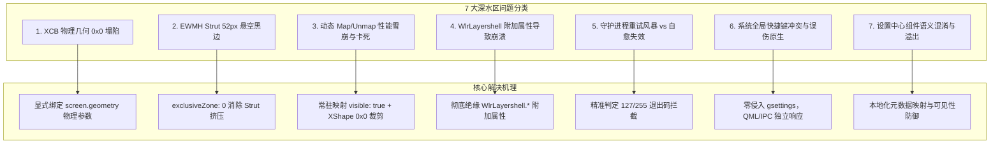
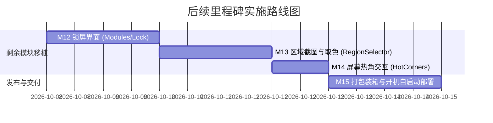

# Ubuntu Quickshell 桌面 Shell：Agent 权威交接文档与全周期踩坑复盘预防手册
*(Canonical Agent Handover, Post-Mortem Analysis, and Prevention Guide)*

> **目标受众**：下一任接手本项目的开发 Agent 与维护工程师  
> **基准参考源**：`reference/StatIndet-quickshell/` (Clavis Desktop Shell)  
> **目标宿主环境**：Ubuntu 24.04 LTS (GNOME 46 / Mutter, X11/XCB, Nix Flake Quickshell 0.3.1)  
> **当前版本基线**：Milestone 11 完结，Git Commit `f42fd15`  
> **文档状态**：权威指导文档 (Canonical & Binding)

---

## 一、 快速导读与项目交接现状 (Executive Summary)

### 1.1 项目全景与使命
本项目旨在将上游 Arch Linux / Niri 环境下的现代化极致液态桌面 Shell（Clavis / StatIndet-quickshell）**1:1 源码级无损移植**至 **Ubuntu 24.04 LTS (GNOME 46 Mutter)** 环境。
系统依托 **Quickshell 0.3.1**，基于 Google Material 3 (M3) 设计规范与 Matugen 算法，实现全桌面根据壁纸实时自适应配色、极清矢量微件、毫秒级响应动效以及与底层 Ubuntu 系统服务的深度整合。

### 1.2 里程碑交付矩阵 (M1 ~ M11 就绪状态)

| 里程碑 | 模块名称 | 核心文件与职责 | 就绪状态 | 关键交付 Commit |
| :--- | :--- | :--- | :---: | :--- |
| **M1** | 设计系统令牌 | `src/Common/`（Appearance、Metrics、Typography、M3 配色引擎） | ✅ 100% | `504097a` |
| **M2** | 基础矢量控件 | `src/Components/`、`src/Widgets/`（MaterialSymbol、SplitSlider 等） | ✅ 100% | `9dd4e88` |
| **M3** | 控制中心底板与侧栏宿主 | `src/Modules/QuickSettings/`、`src/Modules/Sidebars/SidebarHostWindow.qml` | ✅ 100% | `a1b92c3` |
| **M4** | 顶部状态栏 | `src/Modules/Bar/`（HorizontalBarWindow、TopBar 状态胶囊） | ✅ 100% | `2b84f28` |
| **M5** | 系统底层适配服务 | `src/Services/`（PipeWire 音频、UPower 电池、NetworkManager 网络） | ✅ 100% | `a7ca6d5` |
| **M6** | 左侧抽屉与系统卡片 | `src/Modules/Sidebars/Dashboard/`、`src/Modules/SystemCards/` | ✅ 100% | `fb7dbe5` |
| **M7** | 顶部灵动岛中枢 | `src/Modules/Keystone/`（KeystoneSurface、媒体控制、动态时钟） | ✅ 100% | `08d7ebd` |
| **M8** | 底部流体 Dock 栏 | `src/Modules/Dock/`（DockSurface、38px 黄金微调、支持 32-80px 调节） | ✅ 100% | `55b324c` |
| **M9** | Spotlight 聚光灯启动器 | `src/Modules/Launcher/`（LauncherWindow、全能搜索、纯 QML 剪贴板） | ✅ 100% | `72f0c63` |
| **M10** | ControlCenter 设置中心 | `src/Modules/ControlCenter/`（72 个设置组件、图形化 Dock 尺寸与按键） | ✅ 100% | `dc98442` |
| **M11** | 电源会话与桌面卡片层 | `src/Modules/PowerMenu/`（6 键液态电源面板）、`src/Modules/DesktopCards/` | ✅ 100% | `28c8320` / `f42fd15` |

### 1.3 跨平台纯 QML Shim 资产资产库 (Zero C++ Dependency)
为解耦上游 Arch Linux 专属的 C++ 动态库依赖，已构建以下纯 QML/JS 垫片：
1. **`imports/Clavis/Keyboard/ShortcutRecorder.qml`**：替代 C++ 按键录制插件；
2. **`imports/Clavis/DesktopCards/WallpaperAnalyzer.qml`**：替代 C++ 图像壁纸分析器；
3. **`imports/Clavis/Runtime/ConfigFileWatch.qml`**：纯 QML 配置文件热重载监听器；
4. **`imports/Clavis/Runtime/IconThemeController.qml`**：纯 QML 系统图标枚举控制器。

---

## 二、 7 大深水区典型踩坑全复盘 (Deep Post-Mortem)

在前序开发过程中，曾遇到 7 个严重影响系统稳定性、可用性与性能的深水区问题。以下详细记录现象、根本原因分析、失败尝试及最终完美解决方案，下一任 Agent **必须严格研读，坚决避免重蹈覆辙**：



---

### 问题 1：Mutter XCB 物理几何 0x0 塌陷
- **典型现象**：QML 编译通过，后台日志显示 `Configuration Loaded`，但屏幕上没有任何 UI 显示，`xwininfo -root -tree` 显示窗口尺寸为 `0x0`。
- **根本原因**：上游 Wayland 下依赖 `WlrLayershell`，由合成器根据 anchors 自动拉伸铺满屏幕；但在 Ubuntu GNOME (Mutter X11) 下，Quickshell 以 `override-redirect` 窗口运行，Mutter **绝不会**响应纯 QML anchors 进行拉伸。若顶层 PanelWindow 未显式指定宽高，其物理尺寸沦为 `0x0`。
- **失败做法**：单纯增加 `anchors.fill: parent`（无效）。
- **终极解法**：在所有最外层 Window 显式将尺寸绑定至物理参数：
  ```qml
  screen: Quickshell.screens && Quickshell.screens.length > 0 ? Quickshell.screens[0] : null
  property int x: screen && screen.geometry ? screen.geometry.x : 0
  property int y: screen && screen.geometry ? screen.geometry.y : 0
  implicitWidth: screen && screen.geometry ? screen.geometry.width : 1920
  implicitHeight: screen && screen.geometry ? screen.geometry.height : 1080
  ```

---

### 问题 2：EWMH Strut 避让导致顶部灵动岛出现 52px 悬空黑边
- **典型现象**：Keystone 灵动岛下移至 `y = 52`，上方留出一整条物理黑边，无法紧贴屏幕顶边。
- **根本原因**：`HorizontalBarWindow.qml` 曾配置了 `exclusiveZone: 52`。Quickshell 在 X11 下将其转译为 EWMH 协议的 `_NET_WM_STRUT_PARTIAL`，Mutter 据此把全屏工作区（`_NET_WORKAREA`）全局下推 52px，导致后续创建的居顶窗口被 Mutter 强行下压。
- **终极解法**：当顶部存在顶栏与灵动岛多层并存时，顶栏必须显式声明 `exclusiveZone: 0`，确保灵动岛等浮层物理精确咬合物理顶边 `y: 0`。

---

### 问题 3：全屏宿主动态 Map/Unmap 导致的整机严重卡顿 (Freeze & Lag)
- **典型现象**：呼出侧栏抽屉、控制中心或搜索栏时，整机严重掉帧 2~4 秒，鼠标停滞，甚至引起其他前台程序内存抖动；收起后桌面点击失灵。
- **根本原因**：
  1. 在 X11 CPU 软渲染模式下，全屏透明窗口动态切换 `visible: true / false` 会迫使 XServer 为 2K 分辨率窗口重新分配 Backing Store 内存，并触发 `CompositorBlurRegion` 同步执行全屏抓图（`XGetImage`），引发计算雪崩；
  2. 若 `mask: Region` 在关闭时被传入 `null`，XShape 协议会失效并默认拦截全屏鼠标事件，引发输入死锁。
- **终极解法（XShape 物理裁剪法则）**：
  - 宿主窗口必须**保持常驻物理映射（`visible: true`）**；
  - 收起不可见时，通过向 `mask: Region` 提供显式的 `0x0` 空白 Item (`emptyMaskRegion`)，利用 XShape 物理“挖空”事件接收区，实现零开销事件穿透；
  - 展开时切换为 `interactionRegion` 并使用 `opacity` 实现毫秒级平滑过渡。

---

### 问题 4：WlrLayershell 附加属性导致 Mutter XCB OpenGL 上下文崩溃
- **典型现象**：`PowerMenuWindow` 与 `DesktopCardHost` 在编译时无报错，但激活时没有任何 UI 呈现，终端报错：
  ```text
  WARN scene: Could not create attached properties object 'qs::wayland::layershell::WlrLayershell'
  ERROR: Failed to create graphics context for qs::wayland::layershell::WlrLayershell: "Failed to initialize graphics backend for OpenGL."
  ```
- **根本原因**：Mutter 运行在 X11 (XCB) 下，根本不支持 Wayland Layer Shell。一旦在窗口上挂载了 `WlrLayershell.*` 附加属性，Quickshell 在创建和显示该窗口时会尝试初始化 Wayland 图形上下文并失败，导致整个窗口无法呈现。
- **终极解法**：在所有宿主窗口中，**彻底注释或移除所有 `WlrLayershell.*` 属性**（如 `WlrLayershell.namespace`、`WlrLayershell.layer`、`WlrLayershell.keyboardFocus`、`WlrLayershell.exclusionMode`）。

---

### 问题 5：后台专属守护进程缺失时的无限重试风暴 vs 过度拦截导致崩溃自愈失效
- **典型现象**：
  1. 上游强依赖 `key` 二进制，缺失时触发重试定时器，打满 CPU 100%；
  2. 修复时若简单使用 `if (exitCode !== 0)` 中断重连，导致正常运行时若进程因异常闪退后无法重新拉起。
- **终极解法（守护进程自愈韧性法则）**：
  - 精准拦截启动失败退出码：仅当 `exitCode < 0 || exitCode === 127 || exitCode === 255`（代表命令不存在或环境缺失）时标记为不可用并停止重试；
  - 保留退出码为一般崩溃时的正常自愈重连机制（限制最大重试 3 次）。

---

### 问题 6：全局快捷键劫持与误伤 GNOME 原生快捷键
- **典型现象**：脚本尝试通过 `gsettings` 强制解绑 GNOME 原生的 `activate-window-menu` (`Alt+Space`)，导致用户无法唤出原生窗口选项，同时 Quickshell 自定义热键在部分环境下因热键冲突无法响应。
- **根本原因**：违反了“绝对尊重原生桌面环境”的架构红线。
- **终极解法**：
  - 彻底回滚所有对 `gsettings` 的修改；
  - 保留所有系统原生快捷键；
  - Quickshell 自定义快捷键使用独立无冲突按键（如在 ControlCenter 中提供可视化改键支持，或通过 `Ctrl+Alt+S`、`clavis-settings` CLI 进行独立映射）。

---

### 问题 7：设置中心复杂数据绑定的语义混淆与组件溢出
- **典型现象**：打开 ControlCenter 顶栏配置页时，列表出现未支持的 `tray` 选项，图标缺失、描述不明，且布局出现错位。
- **根本原因**：直接搬运了上游 Niri 完整配置模型，未做环境可用性过滤与本地化描述防护。
- **终极解法**：
  - 在 `PersonalizationConfig.qml` 中建立统一的组件元数据映射表（中英文双语 label 与 description）；
  - 过滤掉当前平台尚未就绪的项，确保呈现在 UI 上的所有开关都有明确的系统响应。

---

## 三、 面向下一任 Agent 的 5 大开发预防铁律 (Prevention Commandments)

为了保证后续开发质量，所有后续 Agent 必须将以下 5 条铁律作为刚性执行准则：

### 铁律 1：Mutter X11 窗口宿主三要素
凡是创建或修改任何窗口（PanelWindow / FloatingWindow）：
1. **显式物理几何**：显式设定 `screen`、`x`、`y`、`implicitWidth`、`implicitHeight` 绑定至 `screen.geometry`；
2. **常驻物理映射**：保持 `visible: true`，严禁在 X11 下动态 Map/Unmap。隐藏时必须向 `mask: Region` 提供 `emptyMaskRegion (0x0)`；
3. **零 Layershell 附加属性**：**严禁出现任何未经注释的 `WlrLayershell.*`**！

### 铁律 2：零原生系统侵入准则 (Non-Intrusive)
- **绝对严禁修改 `gsettings`**；
- **绝对严禁覆写用户的原生 GNOME 键位**；
- 所有 Quickshell 专属功能均通过 `quickshell ipc` 或设置中心图形界面由用户自主选择。

### 铁律 3：纯 QML/JS 垫片先行准则 (Pure QML Shim First)
- 遇到任何上游 Arch C++ 插件依赖（如 `Clavis.*`），**第一选择必须是在 `imports/Clavis/...` 下使用纯 QML / JS 编写 Mock / Shim**；
- 严禁在 Ubuntu 宿主环境下引入非标准 C++ 编译链，确保 `nix develop` 能够即拉即跑。

### 铁律 4：进程守护韧性法则 (Resilience First)
- 外部进程调用必须考虑二进制不存在的降级路径；
- 只有在 `exitCode === 127 || exitCode === 255 || exitCode < 0` 时停止重试，其余情况必须保留崩溃自愈机制。

### 铁律 5：三位一体立体闭环验收准则 (3-in-1 Quality Gate)
验收任何任务时，必须同时满足以下三项标准，**缺一不可判定为完成**：
1. **静态编译冒烟测试**：运行 `./scripts/smoke_test.sh`，退出码为 0，且无任何语法报错；
2. **物理几何尺寸审查**：运行 `xwininfo -root -tree`，确认窗口物理尺寸不为 0x0，坐标无下移悬空；
3. **端到端交互闭环验证**：必须同时测试 **IPC 命令行触发 + 界面鼠标点击 + 键盘快捷键**。

---

## 四、 剩余待移植上游模块与实施路线图 (Remaining Roadmap)

目前主体架构与核心交互（顶栏、侧栏、灵动岛、Dock、聚光灯、设置中心、电源菜单、桌面卡片）均已完成，剩余待移植模块如下：



### 1. Milestone 12: 锁屏界面系统 (`Modules/Lock/`)
- **上游参考源**：`reference/StatIndet-quickshell/Modules/Lock/`
- **核心文件**：`LockWindow.qml`、`LockSurface.qml`、`PamAuth.qml`
- **适配重点**：
  - 遵循常驻映射与 X11 密码输入捕获；
  - 对接 PAM 认证或 `loginctl unlock-session`；
  - 壁纸毛玻璃无缝过渡与时间呈现。

### 2. Milestone 13: 屏幕区域截图与拾色器 (`Modules/RegionSelector/`)
- **上游参考源**：`reference/StatIndet-quickshell/Modules/RegionSelector/`
- **核心文件**：`RegionSelectorWindow.qml`、`ColorPickerPreview.qml`
- **适配重点**：
  - 全屏冻结画布选区；
  - 对接 GNOME 原生截图 DBus API (`org.gnome.Shell.Screenshot`)；
  - 选区坐标实时计算与像素颜色抓取。

### 3. Milestone 14: 屏幕热角交互 (`Modules/HotCorners/`)
- **上游参考源**：`reference/StatIndet-quickshell/Modules/HotCorners/`
- **核心文件**：`HotCornerManager.qml`、`CornerTrigger.qml`
- **适配重点**：
  - 屏幕四角防误触物理区域判定；
  - 触发动作映射（如左上角呼出 Overview、右上角呼出 QuickSettings）。

### 4. Milestone 15: 系统级服务整合与一键发布 (Packaging & Systemd)
- **核心工作**：
  - 创建 Systemd User 服务配置文件：`clavis-desktop-shell.service`；
  - 配置 `scripts/install.sh` 与 `scripts/uninstall.sh`；
  - 编写用户级快速安装部署指南。

---

## 五、 常用开发、调试与验证指令集 (Cheat Sheet)

下一任 Agent 可直接使用以下指令开展工作：

```bash
# 1. 进入标准 Nix 开发环境 (内置 Quickshell 0.3.1)
nix develop

# 2. 运行 3 秒非驻留自动化冒烟测试 (核心门禁)
./scripts/smoke_test.sh

# 3. 正常前台启动桌面 Shell
./scripts/launch.sh

# 4. IPC 交互控制指令集
# --- 呼出/切换设置中心 ---
quickshell ipc -p src/shell.qml call controlcenter toggle
quickshell ipc -p src/shell.qml call controlcenter openSearch general.dock

# --- 呼出/切换聚光灯搜索 ---
quickshell ipc -p src/shell.qml call spotlight toggle

# --- 呼出/切换电源菜单 ---
quickshell ipc -p src/shell.qml call powermenu toggle
quickshell ipc -p src/shell.qml call powermenu trigger lock

# --- 呼出/切换控制中心侧栏 ---
quickshell ipc -p src/shell.qml call sidebar toggle right

# 5. 检查 X11 窗口几何尺寸树
xwininfo -root -tree | grep -E "clavis|Quickshell|HorizontalBar|Sidebar|Keystone|Dock|Power"
```

---

> **结语**：本交接文档汇集了 Milestone 1 至 Milestone 11 期间的所有核心工程成果与血泪教训。请下一任 Agent 严格遵循上述架构与预防铁律，高质量完成剩余模块的移植！
