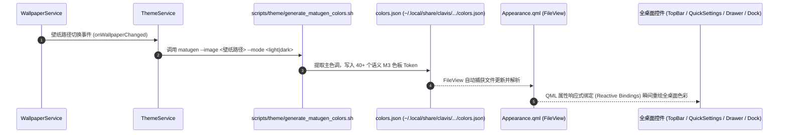
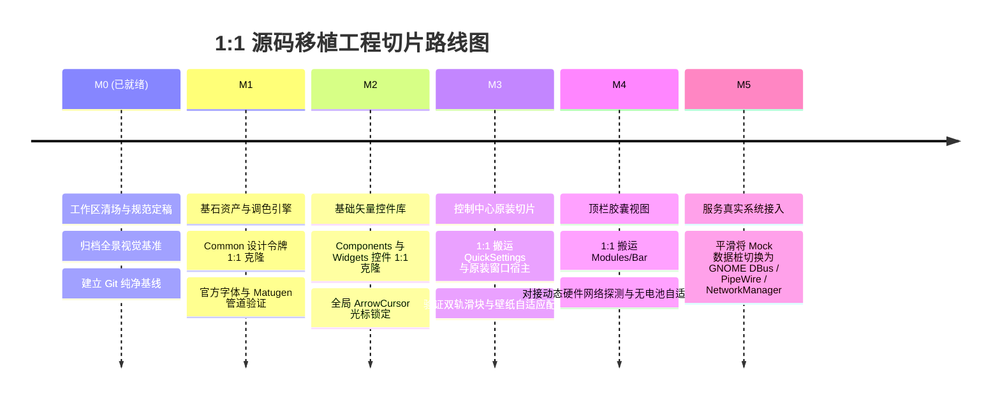
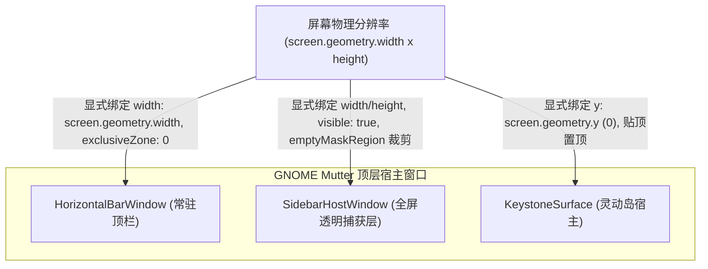

# Ubuntu Quickshell 桌面移植系统权威架构规范 V2
*(Canonical Architecture V2 for Ubuntu Quickshell Desktop Shell)*

> **版本**：2.0.0 (Canonical Edition)  
> **基准参考源**：`reference/StatIndet-quickshell/` (Clavis Desktop Shell)  
> **目标宿主环境**：Ubuntu 24.04 LTS (GNOME 46 / Mutter, Wayland / XWayland)  
> **视觉金标准**：`docs/visual_benchmarks/` (B站参考视频 [BV1JnYY6CEZc](https://www.bilibili.com/video/BV1JnYY6CEZc) 与原版全景基准图)

---

## 一、 系统总体愿景与终极目标 (Executive Vision)

本项目旨在为 **Ubuntu 24.04 LTS** 打造一个具备工业级品质、极致液态质感、且能**随壁纸变换实时自适应配色**的现代桌面 Shell 系统。

### 核心实现效果（参考金标准基准图）
1. **全桌面随壁纸实时自适应配色**：
   - 切换到**青绿草地壁纸**时，顶栏 TopBar、控制中心 Quick Settings、侧边抽屉 Drawer、Dock 栏全系自动浸润在薄荷青绿色调（`#006a66`）；
   - 切换到**蜘蛛侠/暖色壁纸**时，所有固定 UI 控件在毫秒级内自动响应变为暖米色/橄榄棕调（`#6b6038`）；
2. **通透液态毛玻璃与双轨胶囊控件**：
   - 紧凑双轨滑块（MaterialSplitSlider）、极清矢量圆角按键、无 hand-cursor 形变；
3. **零硬编码、全维度硬件自适应**：
   - 一套代码自动兼容台式机（无电池自动隐藏、外接显示器软件调光、有线网络）与笔记本电脑（电池电量指示、Wi-Fi 扫描、硬件背光）。

---

## 二、 1:1 源码级镜像分层架构 (1:1 Architectural Layering)

为彻底阻断前序开发中“自创文件结构、凭空写外壳、破坏设计系统”的弊端，本项目严格执行与上游源码 `reference/StatIndet-quickshell/` 的 **1:1 镜像分层映射**：

```text
src/
├── Common/                    # 【设计系统基石】Appearance、Metrics、Typography、Animations (1:1 镜像)
├── Components/                # 【基础矢量控件】MaterialSymbol、ThemeIcon、SvgIcon 等 (1:1 镜像)
├── Widgets/                   # 【交互复用组件】MaterialSplitSlider、QuickToggleButton、WidgetPanel 等 (1:1 镜像)
├── Modules/                   # 【业务视图切片】(1:1 镜像)
│   ├── Bar/                   # 顶栏胶囊视图 (TopBar, HorizontalBarWindow)
│   ├── QuickSettings/         # 原装快捷设置卡片 (QuickSettingsSurface, QuickSliders)
│   ├── Sidebars/              # 原装宿主侧栏 (SidebarHostWindow, EdgeRevealSurface)
│   ├── Keystone/              # 灵动岛 / 顶部交互弹窗
│   └── Dock/                  # 悬浮应用 Dock 栏
├── Services/                  # 【纯适配服务层】对接系统底层通信与动态数据模型
├── assets/                    # 官方字体 (fonts/) 与矢量资源
└── shell.qml                  # 【顶层启动入口】ShellRoot 调度
```

### 严格的依赖单向性规则
- **`Common/`** 只能被上层引用，严禁反向依赖任何组件或服务；
- **`Components/` & `Widgets/`** 只能依赖 `Common/`，绝不直接发起系统命令；
- **`Modules/` (UI 视图)** 只能声明式绑定 `Services/` 的只读属性，绝不嵌入任何底层系统调用；
- **`Services/`** 负责所有与 GNOME DBus、PipeWire、NetworkManager、UPower 的交互，为上层提供统一接口。

---

## 三、 壁纸自适应配色管道架构 (Matugen M3 Theming Pipeline)

上游 Clavis 的色彩灵魂源于 Google Material 3 算法。本项目通过如下闭环实现全自动壁纸调色：



### 关键调色令牌（Tokens）
- **`Appearance.colors.colPrimary`**：主品牌强调色（滑块激活填充、激活按钮高亮）；
- **`Appearance.colors.colSecondaryContainer`**：次级容器背景（滑块未填充轨道底色）；
- **`Appearance.colors.colLayer0` / `colLayer1`**：卡片底色（配合透明度实现通透液态毛玻璃）；
- **`Appearance.colors.colLayer0Border`**：微光玻璃边缘高亮线条。

---

## 四、 全维度硬件与网络动态自适应规范 (Dynamic Adaptation)

> [!IMPORTANT]
> **绝对准则：严禁在代码中写死任何单机硬件参数！所有硬件差异由程序在运行时自适应侦测。**

### 1. 网络连接动态自适应 (Network Adaptation)
- **数据源**：`NetworkService.qml` 实时监听 NetworkManager 客户端设备树；
- **自适应行为**：
  - 检测到有线网卡且已连接（`wiredConnected`）时，顶栏与控制中心自动呈现有线网络图标（`settings_ethernet`），并抑制 Wi-Fi 列表扫描；
  - 检测到无线网卡（`wifiAvailable`）时，自动呈现 Wi-Fi 信号强度图标并开启可用 SSID 动态发现；
  - 双网或无网状态平滑切换，无需人工配置。

### 2. 电源与电池动态自适应 (Power & Battery Adaptation)
- **数据源**：监听系统 `UPower` D-Bus 接口设备树；
- **自适应行为**：
  ```qml
  readonly property bool hasBattery: {
      return UPower.displayDevice && UPower.displayDevice.isBattery && UPower.displayDevice.powerSupply;
  }
  ```
  - 当 `hasBattery == true`（笔记本、外接供电 UPS）：自动渲染顶栏电池 Pill、电量百分比与充放电指示；
  - 当 `hasBattery == false`（台式机直连市电）：电池相关组件**全自动彻底隐藏（0 像素占位）**，绝不显示虚假 100% 或电量条。

### 3. 显示器与背光模式动态自适应 (Display & Backlight Adaptation)
- **数据源**：`Brightness.qml` 动态枚举 `Quickshell.screens` 及 `/sys/class/backlight/*` 硬件节点；
- **自适应行为**：
  - 若屏幕具备硬件物理背光：滑块拖动直接驱动硬件背光接口；
  - 若为外接独立显示器（如 DP/HDMI 无硬件背光节点）：双轨滑块保持 100% 原版视觉，滑块事件自动平滑分流至 `DisplayColor` 软件遮罩调光（Software Dimmer）。

### 4. 蓝牙与音频设备动态自适应 (Bluetooth & Audio Adaptation)
- **蓝牙**：无蓝牙芯片时，自动标明“Unavailable”并隐藏配对弹窗，有蓝牙时动态列出 AirPods / 蓝牙外设；
- **音频**：实时跟踪 PipeWire 默认 Sink / Source。无可用麦克风时麦克风滑块自动静音或禁用。

---

## 五、 差异分类审查原则 (Differential Justification Gate)

在 1:1 源码移植过程中，Agent 必须对所有与 `reference/` 的代码差异执行严格的动态自检：

| 差异属性 | 判定基准 | 裁决动作 |
| :--- | :--- | :--- |
| **✅ 合法：跨机器硬件自适应** | 补充动态探测、容错判断，使程序能在不同机器（台式机/笔记本/有线/无线）上无缝运转。 | **批准保留** |
| **✅ 合法：窗口宿主与合成器桥接** | 针对 Ubuntu GNOME Mutter X11 的特异性适配（显式几何绑定、`exclusiveZone: 0` 消除 Strut 挤压、常驻映射 + `0x0` XShape 裁剪杜绝卡死）。严禁机械照搬 Wayland 专有属性！ | **强制执行** |
| **✅ 合法：系统守护进程韧性防御** | 针对 Ubuntu 缺失上游私有 CLI 二进制（如 `key`）的优雅降级；同时必须保留运行时崩溃自愈机制。 | **强制执行** |
| **✅ 合法：系统原生光标锁定** | 必须严格保持系统原生 Yaru 箭头光标（`cursorShape: Qt.ArrowCursor`），杜绝手型形变。 | **强制执行** |
| **❌ 违规：审美与排版自作主张** | 擅自调整内边距（padding）、外边距（margins）、圆角（radius）、颜色值、字体比例。 | **一票否决，立即回退** |
| **❌ 违规：结构与功能魔改** | 擅自手写私有包装窗口、拼凑非上游控件、注入破坏性全局 Hook 脚本。 | **一票否决，立即回退** |

---

## 六、 Master-Worker Agent 集群作业 SOP

### 1. 角色职责矩阵
- **主控 Agent (Master Controller)**：
  - 需求统揽、进度把控、向用户负责；
  - 任务切片，签发严格结构化的《子 Agent 任务卡》；
  - 质量总闸门：运行 `git diff` 审计，逐条审查差异合法性，执行非驻留冒烟测试。
- **专业子 Agent (Subagent Workers)**：
  - `AssetTokensPorter`：负责 Common、Fonts、Shaders、Matugen 调色配置的 1:1 克隆；
  - `ComponentPorter`：负责基础矢量控件（Components / Widgets）的 1:1 克隆与光标核查；
  - `ViewModulePorter`：负责原装视图切片（QuickSettings、Bar、Drawer）的宿主装配；
  - `ServiceAdapter`：专门负责在 `Services/` 层打桩对接真实系统，**绝对不触碰 UI 文件**。

### 2. 标准任务卡规范 (Task Card Format)
主控 Agent 派发子任务时必须以标准化任务卡下达：
```yaml
TaskCard:
  Milestone: "M1-Common-Tokens"
  Role: "AssetTokensPorter"
  Scope_Whitelist: ["src/common/*", "src/assets/fonts/*"]
  Ground_Truth_Ref: ["reference/StatIndet-quickshell/Common/*"]
  Allowed_Adaptations: ["动态路径 Paths.qml 对齐当前工程"]
  Forbidden_Actions: ["严禁修改 Appearance 中的 M3 配色算法与尺寸 Token"]
  Verification_Command: ["scripts/smoke_test.sh"]
```

---

## 七、 四大质量防护机制 (Quality Assurance)

1. **数据桩先行协议 (Contract-First Mocking)**：
   - 移植任何 UI 模块前，优先在 `Services/` 提供具备确定性数据的 Mock 数据源（模拟图一中的音量 35%、网络 aaa111 等）；
   - 先确保 UI 呈现出与基准图 100% 像素级一致的视觉，视觉通过后再单独把 Mock 替换为真实系统后端，杜绝 UI 被底层连带破坏。
2. **原子 Git 检查点机制 (Atomic Git Checkpoints)**：
   - 每个任务卡开始前建立 Git commit 检查点；子任务出现污染时，毫秒级 `git reset --hard` 回滚。
3. **金标准视觉基准对照 (Visual Truth Benchmarks)**：
   - 严格以 `docs/visual_benchmarks/` 中的截图为准绳进行视觉对照。
4. **自动化审计与冒烟脚本**：
   - `scripts/audit_diff.sh`：自动对比提取差异；
   - `scripts/smoke_test.sh`：3 秒瞬时拉起测试并立刻干净退出，**绝对零守护、零常驻、零开机自启**。

---

## 八、 里程碑演进路线图 (Milestones Roadmap)



---

## 九、 Ubuntu GNOME 46 Mutter 窗口宿主与平台胶水层规范 (Mutter Window Hosting Bridge)

### 1. 合成器协议鸿沟与 XCB 退化机理
- **原版运行机制**：原版 Clavis 基于支持 `wlr-layer-shell-unstable-v1` 协议的 Wayland 合成器（如 Niri/Hyprland）。在这些合成器中，Quickshell 的 `PanelWindow` 作为 Layer Surface 直接与合成器通信，合成器自动解析 QML `anchors` 并完成全屏或边缘贴靠，原生支持非矩形输入穿透，且全局运行在 GPU 硬件加速管线上；
- **Ubuntu 目标环境**：Ubuntu 24.04 默认使用 **GNOME 46 (Mutter)**。Mutter 原生不支持 `wlr-layer-shell` 协议。Quickshell 在检测到环境时，退化为通过 `QT_QPA_PLATFORM="xcb"`（X11）以无边框、置顶的 override-redirect 窗口运行，且通常运行在 CPU 软渲染模式（`QT_QUICK_BACKEND="software"`）；
- **核心认知更新：规避“机械 1:1 陷阱”**：
  > [!IMPORTANT]
  > **“1:1 移植”指的是 UI 视觉、排版 Token、组件层级与动效参数的 100% 镜像克隆；绝不等于对底层 Window 宿主与系统守护通信代码的盲目照抄！**
  > 若将 Wayland 特有的独占层逻辑与全屏透明机制机械复制到 X11 下，会导致严重的协议冲突、桌面卡死与性能雪崩。

---

### 2. Mutter XCB 平台适配四大铁律

#### 铁律一：0x0 物理几何显式绑定 (Eliminate 0x0 Collapse)
- 在 XCB/XWayland 下，Mutter 绝不会根据 QML anchors 自动拉伸未受管理的 override-redirect 窗口；
- 若窗口未显式绑定物理像素宽高（`width` / `height`），其实际 X11 窗口几何尺寸将沦为 `0x0`，导致视觉上空无一物；
- **规范**：必须在最外层 Window 显式将尺寸绑定至 `screen.geometry` 物理参数。

#### 铁律二：EWMH Strut 避让与层叠并存机制 (Eliminate 52px Gap)
- **机理**：Quickshell 在 X11 下将 `exclusiveZone: 52` 转译为 EWMH 协议的 `_NET_WM_STRUT_PARTIAL`，Mutter 会把桌面工作区（`_NET_WORKAREA`）全局下推 52px，导致后续创建的贴顶窗口（如 Keystone 灵动岛）被强行下压到 `y = 52`，上方暴露整整 52 像素黑边；
- **规范**：当顶部存在横向顶栏与中央灵动岛多层并存时，`HorizontalBarWindow.qml` 必须显式设定 `exclusiveZone: 0`（或开启浮动覆盖模式），确保灵动岛等浮层能够严丝合缝咬合在显示器物理顶边 `y: 0`。

#### 铁律三：全屏宿主常驻映射与 XShape 物理裁剪法则 (Anti-Freeze & Anti-Leak)
- **机理**：
  1. 在 X11 软渲染下，全屏透明宿主窗口**严禁动态切换 `visible`（动态 Map/Unmap）**！动态映射会导致 XServer 重新分配 2048x1100 显存/内存 Backing Store，并迫使 `CompositorBlurRegion` 同步执行全屏抓图（`XGetImage`），引发瞬间数秒的致命卡死并拖垮系统其他进程；
  2. 在 X11 下，`mask: Region` 若被传入 `null`，XShape 会失效并默认捕获全屏事件，造成全屏事件死锁。
- **规范**：
  - 侧栏全屏宿主窗口必须保持常驻映射（`visible: true` 保证生命周期稳定）；
  - 收起不可见时，必须向 `mask: Region` 提供显式的 `0x0` 空白 Item（如 `emptyMaskRegion`），利用 XShape 物理“挖空”事件接收区，既实现零开销事件穿透，又消除重映射的性能雪崩。

#### 铁律四：守护进程缺失防御与崩溃自愈韧性法则 (Daemon Resilience)
- **机理**：上游 QML 强依赖专属 CLI 二进制（如 `key`）。在缺失该命令的宿主环境下，进程启动即失败并触发重试定时器，引发无限重试风暴锁死 QML 事件队列；但若粗暴以 `exitCode !== 0` 中断重连，会彻底破坏正常运行时崩溃后的自愈重连。
- **规范**：
  - 拦截退出码必须精准判定启动失败：`if (exitCode < 0 || exitCode === 127 || exitCode === 255)`；
  - 仅在明确命令不存在或无法执行时停止重试，严禁破坏正常的崩溃恢复循环。

---

### 3. 多宿主窗口显式几何规范 (Multi-Window Hosting Specification)

本项目坚持“**内部控件 100% 镜像，仅在最外层顶层 Window 宿主实施物理几何桥接**”原则：



#### (1) 顶栏宿主：`HorizontalBarWindow.qml`
- **定位**：常驻桌面顶部，提供时间、状态胶囊与快捷设置入口；
- **几何与协议规范**：
  ```qml
  screen: Quickshell.screens && Quickshell.screens.length > 0 ? Quickshell.screens[0] : null
  x: root.screen && root.screen.geometry ? root.screen.geometry.x : 0
  y: root.screen && root.screen.geometry ? root.screen.geometry.y : 0
  width: root.screen && root.screen.geometry ? root.screen.geometry.width : 1920
  height: Sizes.barVisualThickness + Sizes.barOuterEdgeMargin
  exclusiveZone: 0 // 消除 EWMH Strut 对灵动岛的 52px 挤压
  ```

#### (2) 侧栏宿主：`SidebarHostWindow.qml`
- **定位**：覆盖整个屏幕的透明捕获层；
- **几何与输入掩码规范**：
  ```qml
  screen: Quickshell.screens && Quickshell.screens.length > 0 ? Quickshell.screens[0] : null
  x: root.screen && root.screen.geometry ? root.screen.geometry.x : 0
  y: root.screen && root.screen.geometry ? root.screen.geometry.y : 0
  width: root.screen && root.screen.geometry ? root.screen.geometry.width : 1920
  height: root.screen && root.screen.geometry ? root.screen.geometry.height : 1080
  visible: retainedScreen !== null || fallbackScreen !== null // 保持常驻映射，杜绝动态 Map 性能雪崩

  Item {
      id: emptyMaskRegion
      width: 0
      height: 0
  }

  mask: Region {
      // 激活时捕获全屏点击用以关闭，收起时精准收缩为 0x0 物理穿透
      item: root.anySidebarOpen ? interactionRegion : emptyMaskRegion
  }
  ```

#### (3) 灵动岛宿主：`KeystoneSurface.qml`
- **定位**：顶部居中交互中枢；
- **几何要求**：
  ```qml
  screen: Quickshell.screens && Quickshell.screens.length > 0 ? Quickshell.screens[0] : null
  property int x: screen && screen.geometry ? screen.geometry.x : 0
  property int y: screen && screen.geometry ? screen.geometry.y : 0 // 精确咬合物理顶边 y: 0
  ```

---

### 4. 后续 Agent 验收铁律
所有 Agent 必须谨记：**凡是交付涉及窗口渲染的任务，必须实际运行 `./scripts/launch.sh`，以屏幕上肉眼亲眼看到顶栏与控制中心正常渲染、无黑边断层、交互无卡死为唯一验收合格标志**！

