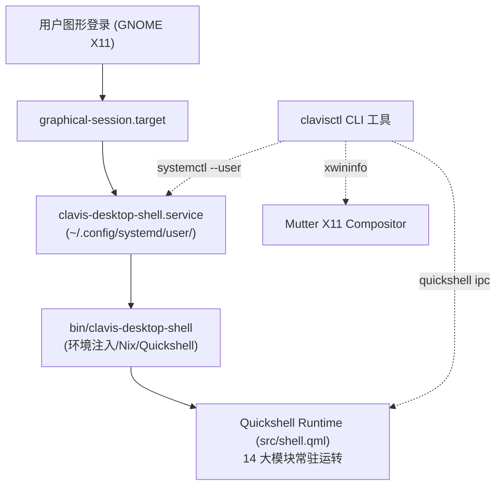

# Clavis Desktop Shell 部署与开机自启运维指南 (Deployment & Autostart Guide)

本文档面向最终用户与系统运维工程师，详细介绍 **Clavis Desktop Shell (Ubuntu Quickshell)** 在 Ubuntu 24.04 LTS (GNOME Mutter X11) 下的安装部署、开机自启、日常运维与排障指南。

---

## 1. 架构概览与依赖环境

Clavis 深度整合了 14 个核心子系统，在 Mutter X11 环境下以原生桌面组件形式呈现：



### 依赖组件
1. **操作系统**：Ubuntu 24.04 LTS (Linux x86_64)；
2. **显示服务**：Mutter X11 / Xwayland (Display `:0`)；
3. **环境管理器**：Nix (Flakes 启用，内置 Quickshell 0.3.1)；
4. **GNOME 扩展**：`hidetopbar@mathieu.bidon.ca`（由 Shell 脚本自动调度隐藏与还原）；
5. **系统主题**：系统自带 Yaru 图标与光标主题。

---

## 2. 快速一键安装部署

在项目根目录下，执行一键安装脚本：

```bash
# 1. 基础安装（部署服务文件与 clavisctl 命令行工具）
./scripts/install.sh

# 2. 一键安装并启用开机自启，同时立即启动服务：
./scripts/install.sh --enable --start
```

### 安装过程执行的操作
- 校验本地 Nix 与 X11 图形环境；
- 部署 Systemd User 服务至 `~/.config/systemd/user/clavis-desktop-shell.service`；
- 部署 XDG 规范开机自启桌面条目至 `~/.config/autostart/clavis-desktop-shell.desktop`；
- 将管理工具 `clavisctl` 和启动器 `clavis-desktop-shell` 软链接至 `~/.local/bin/`。

---

## 3. 命令行管理工具 (`clavisctl`)

安装后可直接在终端中运行 `clavisctl`（需确保 `~/.local/bin` 在 `$PATH` 中）：

```bash
# 查看桌面 Shell 全面健康状态（服务状态、PID、X11 窗口几何树、IPC 响应）
clavisctl status

# 启动服务
clavisctl start

# 停止服务并自动恢复 GNOME 原生顶栏
clavisctl stop

# 平滑重启服务
clavisctl restart

# 实时查看 Systemd 运行日志
clavisctl logs -f
```

### 快捷交互指令

```bash
# 呼出 / 切换聚光灯搜索 (Spotlight Launcher)
clavisctl toggle spotlight

# 呼出 / 切换控制中心设置 (Control Center)
clavisctl toggle controlcenter

# 呼出 / 切换电源菜单 (Power Menu)
clavisctl toggle powermenu

# 展开右侧控制中心 (QuickSettings)
clavisctl toggle quicksettings

# 锁定 / 解锁屏幕 (Lock Screen)
clavisctl toggle lock

# 呼出区域截图选区 (Region Screenshot)
clavisctl toggle screenshot

# 呼出屏幕拾色器 (Color Picker)
clavisctl toggle color
```

---

## 4. Systemd 原生服务控制

除了 `clavisctl` 外，您也可以直接使用 Linux 标准 `systemctl --user` 进行精细控制：

```bash
# 启动
systemctl --user start clavis-desktop-shell.service

# 停止
systemctl --user stop clavis-desktop-shell.service

# 设置开机自启
systemctl --user enable clavis-desktop-shell.service

# 禁用开机自启
systemctl --user disable clavis-desktop-shell.service

# 查看服务状态
systemctl --user status clavis-desktop-shell.service
```

---

## 5. 故障排查与自愈机制 (Troubleshooting)

### 1. 窗口未显示或出现 OpenGL 报错
- **检查**：确认是否使用了软件渲染后端 `QT_QUICK_BACKEND=software` 与 X11 平台 `QT_QPA_PLATFORM=xcb`；
- **自愈**：`bin/clavis-desktop-shell` 已默认强行注入上述环境变量，避免驱动层与 Mutter XCB 上下文冲突。

### 2. 检查日志排查异常
```bash
journalctl --user -u clavis-desktop-shell -n 100 --no-pager
```

### 3. 窗口几何位置偏离
运行以下命令检查当前物理窗口坐标是否贴合屏幕：
```bash
xwininfo -root -tree | grep -E "8x8|2048x88|2048x1152"
```
正常情况下：
- 顶栏为 `2048x88+0+0`；
- 侧边栏/锁屏为全屏 `2048x1152+0+0`；
- 四角热区为 4 个紧凑 `8x8` 窗口位于极端角像素点。

---

## 6. 一键彻底卸载与还原系统

如果您希望彻底停用并恢复系统到初始状态，运行：

```bash
./scripts/uninstall.sh
```

### 卸载脚本执行的操作：
1. 立即停止并禁用 `clavis-desktop-shell.service`；
2. 清理 `~/.config/systemd/user/` 下的服务文件并重载 systemd；
3. 清理 `~/.config/autostart/` 下的桌面自启项；
4. 移除 `~/.local/bin/` 下的软链接；
5. 清理所有残留进程，并自动重新启用 GNOME 原生顶栏。
